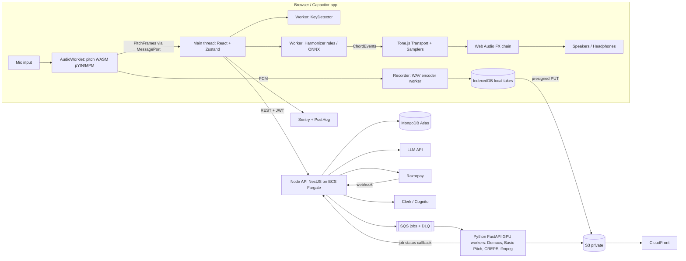

# Sur – AI Music Studio: Technical & Feature Specification v1

- **Owner:** Prajwal Ladkat (full-stack developer, Pune; React, Node, MongoDB, AWS)
- **Status:** v1 draft, handover spec for an AI coding agent
- **Date:** 14 Oct 2026
- **Tagline:** You sing. Sur plays along.
- **Companion:** Google Doc "Sur - Tech & Feature Spec v1" (same content)

> How to read this document: MUST / SHOULD / MAY follow RFC 2119. Every feature has an ID (e.g. `ACC-01`) and acceptance criteria (AC). An AC is only met when it can be shown by an automated test or a scripted manual check. Numbers marked **[estimate, verify]** are targets that still need measuring on real devices.

---

## 0. Glossary

| Term | Meaning |
|---|---|
| Sa | Tonic (root) in Indian classical music; the user's chosen base pitch |
| Sargam | Indian solfège: Sa Re Ga Ma Pa Dha Ni (komal/tivra variants) |
| Riyaz | Daily vocal practice |
| Alankar / Paltaa | Patterned scale exercises |
| Tanpura | Drone instrument sounding Sa–Pa (or Sa–Ma / Sa–Ni) |
| Taal | Rhythmic cycle (Teentaal 16, Keherwa 8, Dadra 6, Rupak 7 beats) |
| Meend / Gamak | Glide between notes / oscillation ornament |
| Take | One recording pass (voice + backing, stored as separate tracks) |
| Follow mode | Live accompaniment that predicts chords from the melody sung so far |
| LUFS | Loudness unit (integrated loudness) |

---

## 1. Overview & Goals

### 1.1 Problem
Many singers, especially Indian cover singers and vocal students, cannot play an instrument. To make a cover or practise, they depend on karaoke tracks (fixed key and tempo, often copyrighted), or on a friend who plays. Existing AI tools either replace the singer (text-to-song) or only work on finished audio.

### 1.2 Product vision
Sur is a browser-first (PWA) music studio where the user **sings first** and the app **accompanies them live**: it detects the key from one phrase, plays chords that follow the melody, records voice and backing on separate tracks, applies a one-click vocal mix, and exports a shareable audio file or 9:16 video.

### 1.3 Goals (v1 / first 12 weeks)
1. Live accompaniment that follows a solo voice, with chord changes snapped to beats and no audible flicker.
2. Riyaz tools: pitch meter (Western + sargam), tanpura at the user's Sa, range finder.
3. End-to-end flow from sing to share in under 3 minutes for a first-time user.
4. Live audio processing stays on the device (privacy and latency).
5. Runs on mid/low-end Android (Capacitor) as well as desktop Chrome/Edge/Firefox/Safari.
6. 50-user beta in Pune by week 8; public launch with Razorpay billing by week 12.

### 1.4 Target users

| Persona | Description | Key needs |
|---|---|---|
| P1 Cover singer | Indian, 16–30, sings Bollywood/indie covers for Instagram Reels/YouTube Shorts, does not play an instrument | Backing that follows their key, quick nice-sounding mix, 9:16 video |
| P2 Classical student | Hindustani or Carnatic vocal student | Tanpura at their Sa, sargam pitch meter, alankar exercises with scoring and streaks, taal |
| P3 Indie songwriter | Writes melodies and lyrics, limited instrument skill | Capture ideas as audio + MIDI + chords, chord sheet export, reharmonisation, lyric help in Hindi/Hinglish |

### 1.5 Non-goals (MUST NOT be built)
- **No text-to-song generation.** Sur never generates a full song or vocal from a prompt.
- **No dependency on Suno, Udio or similar** generative song services (legal risk; see §8 and references).
- **No hosting or distribution of copyrighted backing tracks.** Sur's accompaniment is synthesised live from own/CC0 samples. User-uploaded songs are processed for private practice only and never shared publicly.
- No full DAW feature parity (no VST hosting, no arbitrary plugin chains) in v1.
- No social feed/discovery algorithm in MVP (share links only).

### 1.6 Success metrics

| Metric | Target |
|---|---|
| Time from first open to first finished take | < 3 min (median) |
| Chord flicker (changes not on a beat boundary) | 0 |
| Users rating accompaniment "fits my song" ≥ 4/5 | ≥ 60% of beta users |
| D7 retention (beta) | ≥ 25% |
| Free → Pro conversion (post-launch) | ≥ 3% |

---

## 2. User Stories & Core Flows

### 2.1 User stories

| ID | As a… | I want to… | So that… |
|---|---|---|---|
| US-01 | cover singer | sing one phrase and have Sur find my key | I don't need to know music theory |
| US-02 | cover singer | hear chords that follow my melody while I sing | I sound like I have a band |
| US-03 | cover singer | lock the key and hold a chord | the backing doesn't wander when I go off-key or sustain |
| US-04 | cover singer | record and apply a one-click vocal mix | my take sounds polished |
| US-05 | cover singer | export a 9:16 video with a waveform/lyrics | I can post it to Reels/Shorts |
| US-06 | classical student | set my Sa and hear a tanpura | I can do riyaz anywhere |
| US-07 | classical student | see my pitch in sargam in real time | I can correct my sur |
| US-08 | classical student | do alankar exercises with a score and streak | I stay consistent |
| US-09 | songwriter | save takes as audio + MIDI + chords | I can develop ideas later |
| US-10 | songwriter | export a chord sheet | I can share it with a guitarist |
| US-11 | any user | find my vocal range | I pick songs and keys that suit me |
| US-12 | any user | see a report after each take | I know how accurate I was |

### 2.2 Core flow: sing → key detect → live accompaniment → record → mix → share

1. **Setup** (first run only): grant mic permission → choose headphones type (wired / Bluetooth / speaker) → run the **latency calibration tap test** (§4.5) → optional range finder.
2. **Sing a phrase** ("Listen" state): user sings 4–8 s a cappella. The pitch detector streams notes; the key detector proposes a key (Western) and a Sa (Indian mode) with a confidence value.
3. **Confirm key**: UI shows "You're in G major (Sa = G)" with ± semitone nudge buttons and a **Lock key** toggle.
4. **Choose style**: Pad / Piano / Strum guitar, tempo preset (Slow 70, Medium 90, Upbeat 110 BPM, or tap tempo), rhythm loop (tabla / drums / none).
5. **Live accompaniment**: count-in (1 bar) → user sings → harmoniser predicts the next chord from the melody so far and changes chords only on beats 1 and 3. User can tap **Hold chord**.
6. **Record**: recording starts with the count-in; voice and backing are written to **separate tracks**. Stop → take saved locally (IndexedDB) immediately.
7. **Review**: waveform (wavesurfer.js), post-take report (pitch accuracy %, range, key), retake/keep.
8. **Mix**: one-click vocal chain (HPF → compressor → EQ → reverb) + loudness normalisation; voice/backing balance slider.
9. **Export / share**: WAV/MP3 download, share link, 9:16 video render (server job).

### 2.3 Flow state machine (Studio screen)

| State | Entry | Exit events |
|---|---|---|
| `idle` | app open | `startListen` |
| `listening` | mic open, detecting key | `keyDetected` → `keyConfirm`; `cancel` → `idle` |
| `keyConfirm` | key proposal shown | `confirm` → `ready`; `relisten` → `listening` |
| `ready` | key + style chosen | `play` → `accompanying`; `record` → `countIn` |
| `countIn` | 1 bar metronome | after 1 bar → `recording` |
| `accompanying` | backing plays, not recording | `stop` → `ready`; `record` → `countIn` |
| `recording` | backing + mic recorded | `stop` → `review` |
| `review` | take report shown | `keep` → `mix`; `retake` → `ready` |
| `mix` | mix controls | `export` → `exporting`; `back` → `review` |
| `exporting` | local encode or server job | `done` → `shared` / `mix` |

---

## 3. Feature Specification by Module

Priority key: **MVP** = weeks 1–4 (core) and 5–8 (beta); **v2** = weeks 5–12 or right after launch; **Later** = post-launch backlog.

### 3.1 Practice / Riyaz (module `RYZ`)

| ID | Feature | Priority |
|---|---|---|
| RYZ-01 | Live pitch meter (Western notes + sargam) | MVP |
| RYZ-02 | Tanpura drone at user Sa | MVP |
| RYZ-03 | Range finder | MVP |
| RYZ-04 | Alankar / paltaa exercises with scoring and streaks | v2 |
| RYZ-05 | Upload a song → practice track with key/pitch/tempo controls | v2 |
| RYZ-06 | Raga-aware feedback | Later |
| RYZ-07 | Meend / gamak visualisation | Later |

#### RYZ-01 Live pitch meter (MVP)
- **Description:** Real-time display of the sung pitch as a note name (C4, D#4…) and as sargam relative to the user's Sa (Sa, komal Re, Re…, with octave dots: mandra/madhya/taar), plus cents deviation.
- **Inputs:** mic stream (mono, 44.1/48 kHz); Sa frequency (default C#3/C#4 by voice type, user editable); notation mode (`western` | `sargam` | `both`).
- **Outputs:** `PitchFrame {timeMs, f0Hz | null, midi, cents, confidence, rms}` at ≥ 60 frames/s to the UI; a scrolling pitch trace (last 8 s).
- **UI notes:** Large centre note label; horizontal cents needle (−50…+50) coloured green within ±15 c, amber ±15–35 c, red beyond; scrolling trace canvas with Sa/Pa guide lines; toggle Western/Sargam/Both. Must render at 60 fps via `requestAnimationFrame` on canvas (no React re-render per frame).
- **Acceptance criteria:**
  - AC1: For synthetic sine fixtures from 80 Hz to 1000 Hz, the detected f0 is within ±10 cents in ≥ 99% of voiced frames.
  - AC2: For the vocal fixture set, the gross pitch error rate (> 50 cents off reference) is ≤ 3%.
  - AC3: Silence or noise below the RMS gate shows "—" (no note) within 100 ms.
  - AC4: Mic-to-display latency ≤ 50 ms on desktop Chrome **[estimate, verify]**.
  - AC5: Sargam labels are correct for all 12 semitones relative to any Sa (unit test over 12 Sa values × 36 notes).

#### RYZ-02 Tanpura drone at user Sa (MVP)
- **Description:** Looped tanpura drone (Pa–Sa–Sa–Sa', with Ma or Ni tuning options) at the user's Sa.
- **Inputs:** Sa (any semitone, fine-tune ±50 cents), tuning (`Pa` | `Ma` | `Ni`), tempo of plucks (slow/medium/fast), volume.
- **Outputs:** Continuous audio through Tone.js sampler; no gaps on loop.
- **UI notes:** Sa picker (note wheel + "Detect my Sa" button that uses the key detector on a sustained Sa), tuning chips, volume slider; drone can run alongside the pitch meter.
- **Acceptance criteria:**
  - AC1: Drone pitch is within ±3 cents of the set Sa (measured by offline render + pitch detection).
  - AC2: No audible click/gap at loop boundaries over a 10-minute run (automated: no sample discontinuity > threshold in offline render).
  - AC3: Changing Sa takes effect within 1 pluck cycle without stopping playback.
  - AC4: Works offline after first load (samples cached by the service worker).

#### RYZ-03 Range finder (MVP)
- **Description:** Guided test: user sings lowest comfortable note, then glides to highest comfortable note. Sur reports range and a voice-type suggestion and suggests a default Sa.
- **Inputs:** mic; ≥ 300 ms stable pitch required to register a note.
- **Outputs:** `{lowestMidi, highestMidi, rangeSemitones, suggestedSaMidi, voiceTypeHint}` saved to the user profile (local first, synced when logged in).
- **UI notes:** Two-step wizard with a piano-roll strip showing the range; result card shareable as image (later).
- **Acceptance criteria:**
  - AC1: A note is only counted if stable within ±50 cents for ≥ 300 ms (rejects cracks/glitches).
  - AC2: Result is persisted and used as the default Sa on the next session.
  - AC3: Test completes in ≤ 60 s.

#### RYZ-04 Alankar / paltaa exercises with scoring and streaks (v2)
- **Description:** Library of exercises (e.g. Sa Re Ga Ma…, Sa Re Sa Re Ga…, aroh/avroh patterns) played as a guide (harmonium/tanpura) at the user's Sa and chosen tempo; the user repeats; Sur scores each note.
- **Inputs:** exercise definition `{id, name, notes: SargamNote[], beatsPerNote, taal?}`, Sa, BPM.
- **Outputs:** per-note score (cents error, timing error), exercise score 0–100, daily streak counter.
- **UI notes:** Notation row lights up per note; target band overlay on pitch trace; streak flame and calendar.
- **Acceptance criteria:**
  - AC1: Score = mean over notes of max(0, 100 − |cents error|×2) weighted by voiced coverage; documented and unit-tested.
  - AC2: Streak increments once per calendar day (user's local timezone) when ≥ 1 exercise is completed with score ≥ 50.
  - AC3: ≥ 20 built-in exercises at launch, defined as JSON in `packages/shared-types/exercises`.

#### RYZ-05 Upload a song → practice track (v2)
- **Description:** User uploads a song they own/have for private practice. Server job runs Demucs to separate vocals and accompaniment; user gets an instrumental with key shift (±6 semitones), tempo (50–150%) and a guide-vocal volume control.
- **Inputs:** audio file (MP3/WAV/M4A, ≤ 15 min, ≤ 50 MB) via presigned S3 upload; consent checkbox "for my private practice only".
- **Outputs:** stems (vocals, accompaniment) stored privately in S3; playback with Rubber Band (WASM) pitch/tempo.
- **UI notes:** Upload card shows job progress (queued/processing/done/failed). Stems are never public; the share button is disabled for projects that contain separated stems.
- **Acceptance criteria:**
  - AC1: Stems are only accessible via short-lived presigned GET URLs (≤ 15 min) to the owner.
  - AC2: Any share/render-video request on a project containing third-party stems returns 403 `STEMS_NOT_SHAREABLE`.
  - AC3: Stems auto-delete after 30 days of inactivity (S3 lifecycle rule).
  - AC4: A 4-minute song is processed in ≤ 90 s p50 on a GPU worker **[estimate, verify]**.

#### RYZ-06 Raga-aware feedback (Later)
- Select a raga (e.g. Yaman, Bhupali, Bhairav); flag notes outside the raga's allowed swaras and characteristic phrases (pakad). AC to be defined after a classical-teacher review.

#### RYZ-07 Meend / gamak visualisation (Later)
- Render continuous pitch curves with glide/oscillation detection highlighting; compare against a teacher's reference recording.

### 3.2 Live Accompaniment (module `ACC`)

| ID | Feature | Priority |
|---|---|---|
| ACC-01 | Key detection from one phrase | MVP |
| ACC-02 | Follow mode harmoniser (rule-based, beat-snapped chords on beats 1 and 3) | MVP |
| ACC-03 | Styles: pad / piano / strum | MVP |
| ACC-04 | Tempo presets + tap tempo | MVP |
| ACC-05 | Tabla / drum loop | MVP |
| ACC-06 | Lock key, Hold chord | MVP |
| ACC-07 | ONNX chord model (ReaLchords-style) | v2 |
| ACC-08 | Next-chord preview | v2 |
| ACC-09 | Taal mode following tempo drift (Teentaal, Keherwa, Dadra, Rupak) | v2 |
| ACC-10 | Reactive bass/drums | Later |
| ACC-11 | Native low-latency apps (Oboe on Android) | Later |

#### ACC-01 Key detection from one phrase (MVP)
- **Description:** From 4–8 s of singing, estimate the key using Krumhansl–Schmuckler key profiles over a duration-weighted pitch-class histogram; in Indian mode, estimate Sa (tonic) instead of a major/minor key.
- **Inputs:** stream of `PitchFrame`s (voiced, confidence ≥ 0.7); mode `western` | `indian`.
- **Outputs:** `KeyEstimate {tonicPc: 0–11, mode: 'major'|'minor', saHz?, confidence: 0–1, alternatives: KeyEstimate[2]}`.
- **Algorithm:** Build a 12-bin histogram weighted by voiced duration (and by 1.5× for notes held ≥ 300 ms and phrase-final notes). Correlate with 24 rotated K–S profiles (Pearson). Indian mode: Sa = pitch class maximising (Sa weight + Pa weight × 0.6 + phrase-final weight), constrained to user range.
- **UI notes:** Show the top result plus two alternatives as chips; ± semitone nudge; confidence bar. If confidence < 0.5, prompt "Sing a bit more".
- **Acceptance criteria:**
  - AC1: On the labelled test set (≥ 50 phrases of known songs sung by ≥ 5 singers), top-1 key accuracy ≥ 80%, top-3 ≥ 95% (relative/parallel confusions counted as top-3).
  - AC2: First estimate available ≤ 8 s after singing starts, computed in a Web Worker (main thread blocked < 4 ms).
  - AC3: Deterministic: same input frames → same output (unit test).

#### ACC-02 Follow mode harmoniser (MVP)
- **Description:** Predicts the chord for the next half-bar from the melody sung so far and plays it exactly on beat 1 or beat 3 (4/4). Rule-based in MVP.
- **Inputs:** note events from the pitch detector (quantised to 16ths), key (locked or detected), tempo/transport position, style.
- **Outputs:** `ChordEvent {bar, beat: 1|3, symbol: 'G'|'Em'|..., romanNumeral, pitches: number[], confidence, source: 'rules'|'onnx'|'hold'}` scheduled on the Tone.js transport.
- **Algorithm (rules v1):**
  1. Candidate set = 7 diatonic triads of the key (+ V7, and bVII in major as an option toggle). For Indian mode use the major scale of Sa unless user picks another thaat.
  2. For the window = last 2 beats of melody (decay weight 0.5 for the 2 beats before that), score each candidate: `score = Σ duration(note) × w(note ∈ chord tones: 1.0, scale non-chord tone: 0.2, out-of-key: −0.5)` + `transitionWeight[prevChord][candidate]` (table in `packages/audio-engine/harmonizer/transitions.ts`, favouring I–IV–V–vi motion; see Appendix B) + `stayBonus` (0.3) for the current chord.
  3. **Hysteresis / anti-flicker:** change chord only if the best candidate beats the current chord by margin ≥ 0.25 **and** the change falls on beat 1 or 3. The decision is made `decisionLeadMs` (default 120 ms) before the beat so audio can be scheduled ahead of time.
  4. If no voiced notes in the window → hold current chord. First chord of a phrase defaults to I.
- **UI notes:** Large current-chord label, small "next" ghost label (v2), beat indicator (4 dots). Chord timeline under the waveform.
- **Acceptance criteria:**
  - AC1: 100% of chord changes land on beat 1 or 3 (±5 ms of the transport position) — automated test with an offline transport.
  - AC2: No chord lasts shorter than 2 beats (no flicker), except when the user taps Hold/Release.
  - AC3: On the melody fixture set (MIDI melodies with ground-truth chords), the rule harmoniser agrees with the ground-truth chord function ≥ 55% of half-bars **[baseline estimate, verify]**; used as the A/B baseline for ACC-07.
  - AC4: Harmoniser computation per decision < 2 ms on a mid-range Android phone (Web Worker).

#### ACC-03 Styles (MVP)
- **Description:** Three accompaniment styles rendered from the same chord events: **Pad** (sustained voicings, slow attack), **Piano** (block/broken chords per style pattern), **Strum** (acoustic guitar down/up strum pattern).
- **Inputs:** `ChordEvent`s, style ID, voicing range (keep voicings in C3–C5, avoid user's melody range overlap by default).
- **Outputs:** audio from Tone.js `Sampler`s using own/CC0 samples.
- **Style definition (JSON):** `{id, name, instrument, pattern: [{step, notes: 'chord'|'root'|'fifth'|'arp:n', velocity, durationSteps}], swing, tier: 'free'|'pro'}`.
- **Acceptance criteria:** AC1: switching style mid-song takes effect at the next chord change without stopping. AC2: 3 styles are available on the free tier. AC3: all samples total ≤ 15 MB for the free set (lazy-load others).

#### ACC-04 Tempo presets + tap tempo (MVP)
- Presets: Slow 70, Medium 90, Upbeat 110 BPM, plus tap tempo (average of last 4 taps) and manual 50–180 BPM.
- **Acceptance criteria:** tempo change applies at the next bar; tap tempo within ±2 BPM of the true tempo for steady taps.

#### ACC-05 Tabla / drum loop (MVP)
- Loops: tabla theka for Keherwa (8) and Dadra (6) in MVP (as fixed loops), basic pop drum loop, none. Loops follow the transport tempo.
- **Acceptance criteria:** loops are sample-accurate to the transport (no drift > 1 ms over 5 minutes in offline render).

#### ACC-06 Lock key, Hold chord (MVP)
- **Lock key:** freezes key detection; harmoniser uses the locked key. **Hold chord:** freezes the current chord until released (tap or long-press; keyboard shortcut `H`).
- **Acceptance criteria:** while locked, no key change occurs even with out-of-key singing; Hold freezes the chord within the same beat it is pressed and releases on the next beat 1/3.

#### ACC-07 ONNX chord model (v2)
- **Description:** Replace/augment the rules with an online melody-to-chord transformer in the style of ReaLchords (decoder-only, ~8 layers, 512 dims), exported to ONNX and run with ONNX Runtime Web (WASM/WebGPU) in a Web Worker.
- **Inputs:** token sequence of interleaved melody and chord tokens (16th-note frames), key-relative.
- **Outputs:** probability over chord vocabulary for the next half-bar; same `ChordEvent` contract with `source: 'onnx'`.
- **Acceptance criteria:** AC1: inference ≤ 30 ms per decision on desktop, ≤ 80 ms on mid Android **[estimate, verify]**; otherwise fall back to rules. AC2: A/B vs rules with ≥ 30 beta users; ship as default only if "fits" rating improves by ≥ 10% relative. AC3: model file ≤ 25 MB (int8 quantised). AC4: training data licence verified (see §8).

#### ACC-08 Next-chord preview (v2)
- Ghost label of the predicted next chord shown ≥ 1 beat before the change.
- **Acceptance criteria:** preview matches the played chord ≥ 90% of the time (it can only differ if the singer changes course in the last beat).

#### ACC-09 Taal mode (v2)
- **Description:** Tabla follows the singer's tempo drift for Teentaal (16), Keherwa (8), Dadra (6), Rupak (7). Tempo is re-estimated from vocal onsets and user taps; transport BPM is smoothed (max change 3% per cycle). Sam (beat 1) is accented; khali shown in UI.
- **Acceptance criteria:** AC1: correct beat counts and vibhag markings for all 4 taals (unit tests). AC2: following a recorded vocal with ±8% gradual drift, the transport stays within ±60 ms of the singer's beats **[estimate, verify]**.

#### ACC-10 Reactive bass/drums (Later) · ACC-11 Native low-latency apps (Later)
- Bass line and drum fills that react to vocal energy/phrasing. Native Android audio path using Oboe (AAudio) to bring round-trip latency down; iOS via AVAudioEngine.

### 3.3 Songwriting (module `SNG`)

| ID | Feature | Priority |
|---|---|---|
| SNG-01 | Save takes as audio + MIDI + chords | MVP |
| SNG-02 | Chord sheet export | MVP |
| SNG-03 | Hum-to-MIDI (Spotify Basic Pitch) | v2 |
| SNG-04 | Reharmonise suggestions | v2 |
| SNG-05 | Lyric pad with Hindi/Hinglish LLM help | v2 |
| SNG-06 | Arrangement generator (licensed models only) | Later |

- **SNG-01:** Each take stores voice audio, backing audio, the melody as MIDI (from live pitch frames, quantised notes ≥ 80 ms), and the `chordEvents` timeline. AC: a saved take can be re-opened and the backing re-rendered from chord events in a different style with identical timing.
- **SNG-02:** Export chord sheet as PDF and plain text (ChordPro format) with key, tempo, bar-numbered chords and optional lyrics lines; capo suggestion for guitar. AC: ChordPro output parses with a standard ChordPro parser; transpose ± semitones updates all chords.
- **SNG-03:** Server job runs Basic Pitch on the take for higher-quality note transcription → MIDI download. AC: job finishes ≤ 30 s for a 3-min take; output MIDI opens in a DAW (validated with a MIDI parser in tests).
- **SNG-04:** Offer 3 alternative chord progressions for a selected section (e.g. substitute vi for I, add ii–V, borrowed iv); user can audition and apply. AC: suggestions preserve chord-tone coverage of the melody ≥ 60%.
- **SNG-05:** Lyric pad (Devanagari + Latin/Hinglish) with LLM actions: rhyme suggestions, syllable count per line vs melody notes, translate/transliterate, "continue this verse". AC: LLM is called only from the backend; prompts and outputs are not used for training; the user can disable AI help.
- **SNG-06 (Later):** Full arrangement generator only with models whose licence permits commercial use.

### 3.4 Recording / Production (module `REC`)

| ID | Feature | Priority |
|---|---|---|
| REC-01 | Voice and backing as separate tracks | MVP |
| REC-02 | WAV / MP3 export | MVP |
| REC-03 | Multitrack | v2 |
| REC-04 | Punch-in | v2 |
| REC-05 | Gentle pitch correction | v2 |
| REC-06 | Harmony vocals (PSOLA / Rubber Band WASM) | v2 |
| REC-07 | Sing a line → flute or sitar | Later |

- **REC-01:** Voice captured raw (via AudioWorklet to PCM, 48 kHz mono float32) and backing rendered as a separate stereo track (internal bus recording or offline re-render from chord events). Latency compensation offset from calibration is applied to the voice track. AC: after compensation, a click recorded through the loopback test aligns with the backing within ±10 ms; both tracks have identical duration.
- **REC-02:** WAV (16-bit/24-bit, 44.1/48 kHz) encoded in a worker; MP3 (128–320 kbps) via lamejs/WASM encoder in a worker. AC: a 3-min stereo MP3 encodes in ≤ 10 s on mid Android; files play in default OS players.
- **REC-03:** Up to 8 tracks with mute/solo/volume/pan. **REC-04:** Punch-in between two markers with 1-bar pre-roll and 10 ms crossfades. **REC-05:** Gentle pitch correction (strength 0–100%, retune speed 20–200 ms) towards the key scale, offline. **REC-06:** Auto-generate a 3rd/6th harmony following the chord events using PSOLA or Rubber Band WASM. **REC-07 (Later):** convert a sung line into flute or sitar timbre.
- **AC (v2):** punch-in crossfades click-free; pitch correction at 50% strength never moves a note more than its error; harmony stays diatonic to the key.

### 3.5 Mix & Master (module `MIX`)

| ID | Feature | Priority |
|---|---|---|
| MIX-01 | One-click vocal chain (HPF, compressor, EQ, reverb) | MVP |
| MIX-02 | Loudness normalisation | MVP |
| MIX-03 | Auto-mix | v2 |
| MIX-04 | Master presets (Reels, Spotify −14 LUFS) | v2 |
| MIX-05 | Reference-track matching | Later |

- **MIX-01 default chain:** High-pass 90 Hz (12 dB/oct) → compressor (threshold −18 dB, ratio 3:1, attack 10 ms, release 120 ms, knee 6) → EQ (−2 dB @ 300 Hz Q1, +2 dB @ 3 kHz Q1, +1.5 dB shelf @ 10 kHz) → reverb (plate-like convolution IR, wet 15%, pre-delay 20 ms). Presets: Natural, Bollywood Shine, Warm, Classical Hall. Implemented with Web Audio nodes; the same graph is used in `OfflineAudioContext` for export. AC: export of the mixed track matches real-time preview (null-test residual < −60 dBFS).
- **MIX-02:** Integrated loudness measured per ITU-R BS.1770 (K-weighting) in a worker; gain to target (default −14 LUFS) with a true-peak limiter at −1 dBTP. AC: exported files measure −14 ± 0.5 LUFS and ≤ −1 dBTP (verified with ffmpeg `loudnorm` in CI).
- **MIX-03:** Auto-balance voice vs backing (target voice ~3 dB above backing in loudness) and auto EQ based on spectral analysis. **MIX-04:** server-side mastering via ffmpeg loudnorm two-pass; presets: Reels/Shorts (−14 LUFS, −1 dBTP, slight brightening), Spotify (−14 LUFS), Podcast-loud (−16 LUFS). **MIX-05 (Later):** match EQ/loudness to a user reference track.

### 3.6 Learn / Feedback (module `LRN`)

| ID | Feature | Priority |
|---|---|---|
| LRN-01 | Post-take report (pitch accuracy %, range, key) | MVP |
| LRN-02 | AI coach | v2 |
| LRN-03 | Chord lessons | v2 |
| LRN-04 | Teacher dashboard | Later |

- **LRN-01:** After each take: pitch accuracy % (share of voiced frames within ±25 cents of the nearest in-key note), range used (lowest–highest note), detected key/Sa, stability (median absolute cents deviation on held notes), and the 3 weakest notes. AC: report renders ≤ 1 s after stop for a 3-min take; formulas documented and unit-tested; report JSON stored on the take.
- **LRN-02:** LLM coach receives only the take report JSON (not audio) and returns 3 actionable tips in the user's language. AC: no raw audio leaves the device for the coach; responses ≤ 120 words; rate-limited (free 3/day).
- **LRN-03:** Interactive lessons: what a chord is, I–IV–V–vi, why the app chose a chord. **LRN-04 (Later):** teacher views students' streaks/scores and assigns exercises (B2B plan).

### 3.7 Collaborate / Share (module `SHR`)

| ID | Feature | Priority |
|---|---|---|
| SHR-01 | Share link | MVP |
| SHR-02 | 9:16 video render | MVP |
| SHR-03 | Duets | v2 |
| SHR-04 | Remix someone's backing | v2 |
| SHR-05 | Challenges | Later |
| SHR-06 | Style-pack marketplace | Later |

- **SHR-01:** Public page `/s/{slug}` with player (mixed audio), title, singer name, key/tempo, chord timeline; Open Graph tags; optional expiry; owner can revoke. AC: page loads ≤ 2 s on 4G (Lighthouse mobile perf ≥ 85); revoked links return 410.
- **SHR-02:** Server job renders 1080×1920 MP4 (H.264/AAC) with animated waveform, current chord, title, optional user photo/background and a "Made with Sur" watermark on the free tier. AC: 60-s video renders ≤ 60 s p50 **[estimate, verify]**; plays on Instagram/YouTube upload checks; free-tier videos always watermarked.
- **SHR-03:** Duet: second singer records over the first singer's backing + voice. **SHR-04:** Remix: reuse someone's chord events/style (never their voice without permission) if the original is marked remixable.
- **SHR-05/06 (Later):** weekly singing challenges; marketplace for style packs (licensed samples only).

---

## 4. Architecture

### 4.1 Tech stack summary

| Layer | Choice |
|---|---|
| Web client | React 18 + Vite + TypeScript, PWA (Workbox), Tailwind CSS, Zustand (state), wavesurfer.js (waveforms), React Router |
| Audio engine (browser) | AudioWorklet (128-sample render quanta) with WASM pitch detection (pYIN for accuracy, MPM for low latency); Web Workers for key detection and the harmoniser; Tone.js Transport + Sampler; MediaRecorder + custom WAV encoder; Web Audio effects chain |
| ML in browser (v2) | ONNX Runtime Web (WASM, WebGPU when available) for the chord transformer |
| Mobile | Capacitor wrapper for Android (MVP-beta); Oboe native audio module later |
| API | Node.js 20 + NestJS (preferred; Express acceptable) on AWS ECS Fargate (API) and Lambda (webhooks/light tasks) |
| Auth | Clerk (preferred for speed) or AWS Cognito; JWT verified by API |
| Database | MongoDB Atlas (M10+ in prod), Mongoose or native driver with zod schemas |
| Storage/CDN | S3 (private buckets) + CloudFront; presigned PUT uploads, signed GET URLs |
| Jobs | SQS queue (+ DLQ) → Python FastAPI workers |
| ML workers | Python 3.11, FastAPI, GPU (AWS g5 spot instances or Modal): Demucs (stems), Basic Pitch (transcription), CREPE (high-accuracy pitch), ffmpeg loudnorm (mastering), ffmpeg for the 9:16 video render |
| LLM | External LLM API via backend only (coach, lyrics) |
| Observability | Sentry (errors, client + server), PostHog (product analytics, feature flags), CloudWatch logs |
| Payments | Razorpay (UPI, cards; subscriptions) |

### 4.2 Architecture diagram



Text fallback: Mic → AudioWorklet (pitch) → main thread → workers (key, harmoniser) → Tone.js (chords, loops) → FX → output; Recorder → IndexedDB → S3 (presigned); API ↔ MongoDB; API → SQS → GPU workers → S3 → API callback.

### 4.3 Client audio pipeline (data flow)
1. `getUserMedia({audio: {echoCancellation: false, noiseSuppression: false, autoGainControl: false}})` → `MediaStreamAudioSourceNode`.
2. `PitchWorkletNode` (AudioWorklet): accumulates 128-sample blocks into a ring buffer; runs MPM every 256 samples (window 2048 @ 48 kHz) for live display; pYIN path (window 2048, hop 512) for take analysis. Posts `PitchFrame`s through a `MessagePort` (or SharedArrayBuffer ring when cross-origin isolated).
3. Main thread forwards note events (onset/offset segmented, min note 80 ms) to the **KeyDetector worker** and **Harmonizer worker**.
4. Harmonizer returns `ChordEvent`s ≥ `decisionLeadMs` before the target beat; `AccompanimentEngine` schedules them on Tone.Transport (`transport.schedule(time)`), using `Tone.Sampler` per style.
5. Backing → `FxChain` (backing bus) → destination; voice monitoring is OFF by default (latency), optional dry monitoring for wired headphones.
6. Recorder taps the raw mic PCM (pre-FX) and the backing bus separately; writes chunks to IndexedDB every 2 s (crash safety).
7. On save: encode → presigned PUT to S3 → `POST /projects/:id/takes` with metadata → optional jobs.

### 4.4 Server data flow
- Client requests `POST /uploads/presign` → API returns a presigned S3 PUT URL (content-type, max size enforced via policy) → client uploads directly → client calls `POST /projects/:id/takes` with the S3 keys.
- Jobs: `POST /jobs` → API writes a `jobs` doc (status `queued`) → SQS message `{jobId, type, inputKeys, params}` → worker pulls, sets `processing`, writes outputs to S3, calls `POST /internal/jobs/:id/complete` (HMAC-signed) → API updates status → client polls `GET /jobs/:id` (or SSE `GET /jobs/:id/events`).
- Retries: 3 attempts with exponential backoff, then DLQ + status `failed` with an error code.

### 4.5 Latency budget **[all figures estimates, verify on devices]**

| Stage | Desktop, wired headphones | Android mid-range, wired | Bluetooth (any) |
|---|---|---|---|
| Input buffer (OS + browser) | 5–10 ms | 10–30 ms | 10–30 ms |
| AudioWorklet block (128 @ 48 kHz) | 2.7 ms | 2.7 ms | 2.7 ms |
| Pitch analysis window (MPM) | 10–20 ms | 10–20 ms | 10–20 ms |
| Decision + scheduling | ≤ 2 ms | ≤ 5 ms | ≤ 5 ms |
| Output buffer | 5–10 ms | 10–40 ms | 100–250 ms |
| **Total mic-to-speaker** | **target < 40 ms** | 40–100 ms | **can exceed 100 ms** |

Strategy:
- **Predictive, beat-snapped chords** hide latency: chords are decided ahead of the beat from the melody so far (not reacting to the current note), so output latency only shifts the whole backing, which is compensated by the transport offset.
- **Calibration tap test:** user taps along to 8 clicks (or a loopback click through speaker → mic); median offset stored per device + output type (`outputLatencyMs`); applied to scheduling and to recorded voice alignment. Also read `AudioContext.outputLatency` / `baseLatency` when available.
- `AudioContext({latencyHint: 'interactive', sampleRate: 48000})`.
- Bluetooth detected (or user-selected) → disable live monitoring, show a banner "Wired headphones give the best timing".
- Latency test page (`/dev/latency`) is a W1 deliverable.

---

## 5. Data Model (MongoDB)

Conventions: `_id` ObjectId; all docs have `createdAt`, `updatedAt` (UTC); soft delete via `deletedAt`; `ownerId` references `users._id`. Times inside audio are in milliseconds from take start.

### 5.1 `users`
| Field | Type | Notes |
|---|---|---|
| authProviderId | string | Clerk/Cognito subject, unique |
| email | string | unique, lowercase |
| displayName | string | |
| locale | enum `en`,`hi`,`mr`,`ta` | default `en` |
| voice | `{lowestMidi, highestMidi, saMidi, saCents, voiceTypeHint}` | from range finder |
| devices | `[{deviceId, platform, outputType, outputLatencyMs, calibratedAt}]` | |
| plan | `{tier: 'free' / 'pro' / 'classroom', status, renewsAt, razorpaySubscriptionId}` | |
| usage | `{periodStart, savedTakes, videoRenders, coachCalls}` | monthly counters |
| streak | `{current, longest, lastDay: 'YYYY-MM-DD', tz}` | |

Indexes: `{authProviderId:1}` unique; `{email:1}` unique; `{'plan.razorpaySubscriptionId':1}` sparse.

### 5.2 `projects`
| Field | Type | Notes |
|---|---|---|
| ownerId | ObjectId | |
| title | string | ≤ 120 chars |
| key | `{tonicPc, mode, saHz?, locked}` | |
| tempoBpm | number | 50–180 |
| timeSignature | `{num, den}` | e.g. `{num:4,den:4}` |
| taal | enum `teentaal`,`keherwa`,`dadra`,`rupak`, null | |
| styleId | ObjectId | ref `styles` |
| containsThirdPartyStems | boolean | blocks sharing |
| lyrics | string | |
| tags | string[] | |

Indexes: `{ownerId:1, updatedAt:-1}`; `{ownerId:1, deletedAt:1}`.

### 5.3 `takes`
| Field | Type | Notes |
|---|---|---|
| projectId, ownerId | ObjectId | |
| number | int | take index within project |
| durationMs | int | |
| sampleRate | int | 48000 |
| latencyOffsetMs | number | applied alignment |
| trackIds | ObjectId[] | voice, backing, mix |
| report | `{pitchAccuracyPct, rangeLowMidi, rangeHighMidi, key, stabilityCents, weakestNotes[]}` | LRN-01 |
| status | enum `local`,`uploading`,`ready` | |
| starred | boolean | |

Indexes: `{projectId:1, number:1}` unique; `{ownerId:1, createdAt:-1}`.

### 5.4 `tracks`
| Field | Type | Notes |
|---|---|---|
| takeId, projectId, ownerId | ObjectId | |
| kind | enum `voice`,`backing`,`mix`,`stem_vocals`,`stem_accomp`,`harmony`,`master` | |
| s3Key | string | private bucket key |
| format | `{container, codec, bitDepth?, bitrateKbps?, channels}` | container: wav / mp3 / webm |
| durationMs, sizeBytes | int | |
| loudness | `{integratedLufs, truePeakDbtp}` | |
| fx | `{presetId, params}` | FxChain settings |
| gainDb, pan, muted | number / bool | |

Indexes: `{takeId:1, kind:1}`; `{ownerId:1}`.

### 5.5 `chordEvents`
One doc per take (array) to keep reads cheap.

| Field | Type | Notes |
|---|---|---|
| takeId, projectId | ObjectId | |
| engine | `{source, version}` | source: rules / onnx |
| events | `[{tMs, bar, beat, symbol, roman, pitches:int[], confidence, source}]` | sorted by tMs; source: rules / onnx / hold / user |

Indexes: `{takeId:1}` unique.

### 5.6 `midi`
| Field | Type | Notes |
|---|---|---|
| takeId | ObjectId | |
| source | enum `live`,`basic_pitch` | |
| notes | `[{startMs, durMs, midi, velocity, centsOffset}]` | |
| s3Key | string | .mid file |

Indexes: `{takeId:1, source:1}` unique.

### 5.7 `styles`
| Field | Type | Notes |
|---|---|---|
| slug | string | unique, e.g. `soft-pad` |
| name | `{en, hi, mr, ta}` | |
| instrument | enum `piano`,`pad`,`strum_guitar`,`tabla`,`tanpura`,`harmonium`,`dholak`,`drums` | |
| pattern | object | style JSON (§3.2 ACC-03) |
| sampleManifestUrl | string | CloudFront URL |
| licence | `{type, source, notes}` | type: own / CC0; required |
| tier | enum `free`,`pro` | |
| version | int | |

Indexes: `{slug:1}` unique; `{tier:1}`.

### 5.8 `jobs`
| Field | Type | Notes |
|---|---|---|
| ownerId, projectId, takeId | ObjectId | |
| type | enum `stems`,`transcribe`,`master`,`render_video`,`pitch_hq` | |
| status | enum `queued`,`processing`,`done`,`failed`,`cancelled` | |
| params | object | type-specific |
| inputKeys, outputKeys | string[] | S3 keys |
| progress | int 0–100 | |
| attempts | int | |
| error | `{code, message}` | |
| startedAt, finishedAt | Date | |

Indexes: `{ownerId:1, createdAt:-1}`; `{status:1, type:1}`; TTL index on `finishedAt` (90 days).

### 5.9 `shares`
| Field | Type | Notes |
|---|---|---|
| slug | string | 10-char nanoid, unique |
| ownerId, projectId, takeId | ObjectId | |
| mediaKeys | `{audio, video?, poster?}` | |
| visibility | enum `unlisted`,`public` | |
| remixable | boolean | v2 |
| expiresAt | Date? | |
| revokedAt | Date? | |
| stats | `{views, plays}` | |

Indexes: `{slug:1}` unique; `{ownerId:1, createdAt:-1}`; TTL on `expiresAt`.

---

## 6. API Specification

Base URL `/api/v1`. JSON only. Auth: `Authorization: Bearer <JWT>` (Clerk/Cognito) on all endpoints except public share and webhooks. Errors: `{"error": {"code": "STRING_CODE", "message": "...", "details": {}}}` with HTTP 400/401/402/403/404/409/410/422/429/500. Validation via zod (shared schemas in `packages/shared-types`). Pagination: `?cursor=&limit=` (max 50) → `{items, nextCursor}`.

### 6.1 Endpoint list

| Method | Path | Purpose |
|---|---|---|
| GET | /me | current user profile |
| PATCH | /me | update profile, voice, locale, devices |
| GET | /projects | list own projects |
| POST | /projects | create project |
| GET | /projects/:id | get project with takes summary |
| PATCH | /projects/:id | update project |
| DELETE | /projects/:id | soft delete |
| POST | /uploads/presign | presigned S3 PUT URL |
| POST | /projects/:id/takes | register a take with tracks, chords, midi, report |
| GET | /projects/:id/takes | list takes |
| GET | /takes/:id | take with tracks + signed GET URLs |
| DELETE | /takes/:id | soft delete |
| POST | /jobs | create job (stems, transcribe, master, render_video, pitch_hq) |
| GET | /jobs/:id | job status |
| POST | /internal/jobs/:id/complete | worker callback (HMAC) |
| POST | /shares | create share link |
| DELETE | /shares/:slug | revoke |
| GET | /public/shares/:slug | public share data (no auth) |
| POST | /coach | AI coach tips from a take report |
| POST | /lyrics/assist | lyric help |
| POST | /billing/subscribe | create Razorpay subscription |
| POST | /webhooks/razorpay | Razorpay webhook (signature verified) |
| GET | /styles | list styles available to user |

### 6.2 Auth
Auth is delegated to Clerk/Cognito; the client gets a JWT. On the first authenticated call, the API upserts the `users` doc (`GET /me`).

`GET /me` → 200
```json
{"id":"665f...","email":"a@b.com","displayName":"Asha","locale":"hi","voice":{"lowestMidi":53,"highestMidi":74,"saMidi":61,"saCents":0},"plan":{"tier":"free","status":"active"},"usage":{"savedTakes":2,"limitSavedTakes":5}}
```

### 6.3 Projects
`POST /projects`
```json
{"title":"Tum Hi Ho cover","key":{"tonicPc":9,"mode":"minor","locked":true},"tempoBpm":90,"timeSignature":{"num":4,"den":4},"styleId":"6660..."}
```
→ 201 `{"id":"6661...","title":"Tum Hi Ho cover","createdAt":"2026-10-14T10:00:00Z", ...}`

`PATCH /projects/:id` — partial body of the same shape → 200 updated project. `DELETE /projects/:id` → 204.

### 6.4 Presigned upload
`POST /uploads/presign`
```json
{"purpose":"take_track","contentType":"audio/wav","sizeBytes":31457280,"projectId":"6661..."}
```
→ 200
```json
{"uploadUrl":"https://s3...","method":"PUT","headers":{"Content-Type":"audio/wav"},"s3Key":"u/665f/p/6661/tr/01H.wav","expiresAt":"2026-10-14T10:15:00Z"}
```
Rules: `purpose` ∈ `take_track`, `song_upload`, `avatar`; max 100 MB (`song_upload` 50 MB); allowed types `audio/wav`, `audio/mpeg`, `audio/webm`, `audio/mp4`, `image/jpeg`, `image/png`; URL valid 15 min.

### 6.5 Takes
`POST /projects/:id/takes`
```json
{"durationMs":182000,"sampleRate":48000,"latencyOffsetMs":23,
 "tracks":[{"kind":"voice","s3Key":"...voice.wav","format":{"container":"wav","bitDepth":24,"channels":1}},
           {"kind":"backing","s3Key":"...backing.wav","format":{"container":"wav","bitDepth":24,"channels":2}}],
 "chordEvents":{"engine":{"source":"rules","version":"1.0.0"},"events":[{"tMs":0,"bar":1,"beat":1,"symbol":"Am","roman":"i","pitches":[57,60,64],"confidence":0.8,"source":"rules"}]},
 "midi":{"source":"live","notes":[{"startMs":120,"durMs":400,"midi":69,"velocity":90,"centsOffset":-8}]},
 "report":{"pitchAccuracyPct":82.5,"rangeLowMidi":57,"rangeHighMidi":72,"key":{"tonicPc":9,"mode":"minor"},"stabilityCents":14,"weakestNotes":[71,62,65]}}
```
→ 201 `{"id":"6670...","number":3,"status":"ready"}`; 402 `{"error":{"code":"QUOTA_EXCEEDED"}}` when the free monthly limit (5 saved takes) is reached.

`GET /takes/:id` → 200 take with `tracks[].url` (signed CloudFront/S3 GET, 15 min).

### 6.6 Jobs
`POST /jobs`
```json
{"type":"render_video","takeId":"6670...","params":{"aspect":"9:16","durationMs":60000,"startMs":30000,"title":"Tum Hi Ho","background":"gradient-1","showChords":true}}
```
Type-specific params:

| type | params | outputs |
|---|---|---|
| stems | `{s3Key, model:"htdemucs"}` | `stem_vocals`, `stem_accomp` tracks |
| transcribe | `{trackId}` (Basic Pitch) | `midi` doc (source `basic_pitch`) + .mid |
| master | `{trackId, preset, targetLufs:-14, truePeakDbtp:-1}`; preset: reels / spotify / podcast | `master` track |
| render_video | as above | MP4 key + poster |
| pitch_hq | `{trackId}` (CREPE) | pitch curve JSON |

→ 202 `{"id":"6680...","status":"queued"}`

`GET /jobs/:id` → 200 `{"id":"6680...","type":"render_video","status":"processing","progress":40,"outputs":null,"error":null}`; when done `outputs: {"videoUrl":"https://...","posterUrl":"https://..."}`.

`POST /internal/jobs/:id/complete` (worker only; header `X-Sur-Signature: HMAC-SHA256(body, WORKER_CALLBACK_SECRET)`)
```json
{"status":"done","outputKeys":["u/665f/.../video.mp4"],"meta":{"durationMs":60000},"error":null}
```

### 6.7 Share
`POST /shares` `{"takeId":"6670...","visibility":"unlisted","includeVideo":true,"expiresAt":null}` → 201 `{"slug":"x7Kp2Qa9Lm","url":"https://sur.app/s/x7Kp2Qa9Lm"}`; 403 `STEMS_NOT_SHAREABLE` if the project contains third-party stems.

`GET /public/shares/:slug` → 200 `{"title":"...","singer":"Asha","key":"A minor","tempoBpm":90,"audioUrl":"...","videoUrl":"...","chords":[...]}`; 410 if revoked/expired.

### 6.8 Coach & lyrics
`POST /coach` `{"takeId":"6670...","locale":"hi"}` → 200 `{"tips":["...","...","..."]}` (uses stored report only).

`POST /lyrics/assist` `{"action":"rhyme","text":"...","script":"devanagari"}` (action: rhyme / continue / syllables / transliterate; script: devanagari / latin) → 200 `{"suggestions":[...]}`. Rate-limited (429).

### 6.9 Billing
`POST /billing/subscribe` `{"plan":"pro_monthly"}` (or `pro_yearly`) → 200 `{"razorpaySubscriptionId":"sub_...","keyId":"rzp_live_..."}` (client opens Razorpay Checkout).

`POST /webhooks/razorpay` — verify `X-Razorpay-Signature` (HMAC-SHA256 with webhook secret) over the raw body; handle `subscription.activated`, `subscription.charged`, `subscription.halted`, `subscription.cancelled`, `payment.failed`; idempotent by event id (store processed ids, unique index). → 200 `{"ok":true}`.

### 6.10 Client-side audio module interfaces (TypeScript, `packages/audio-engine`)

```ts
export type NotationMode = 'western' | 'sargam' | 'both';

export interface PitchFrame {
  timeMs: number;          // AudioContext time in ms
  f0Hz: number | null;     // null when unvoiced
  midi: number | null;     // fractional MIDI number
  cents: number | null;    // deviation from nearest semitone
  confidence: number;      // 0..1
  rms: number;             // linear RMS of the block
}

export interface NoteEvent { startMs: number; endMs: number; midi: number; meanCents: number; }

export interface PitchDetector {
  readonly algorithm: 'mpm' | 'pyin';
  init(ctx: AudioContext, source: AudioNode, opts?: { minHz?: number; maxHz?: number; rmsGateDb?: number }): Promise<void>;
  onFrame(cb: (f: PitchFrame) => void): () => void;      // returns unsubscribe
  onNote(cb: (n: NoteEvent) => void): () => void;
  analyzeOffline(pcm: Float32Array, sampleRate: number): Promise<PitchFrame[]>; // pYIN for reports
  dispose(): void;
}

export interface KeyEstimate { tonicPc: number; mode: 'major' | 'minor'; saHz?: number; confidence: number; }

export interface KeyDetector {
  setMode(mode: 'western' | 'indian'): void;
  push(note: NoteEvent): void;
  estimate(): KeyEstimate & { alternatives: KeyEstimate[] };
  lock(key: KeyEstimate): void;
  unlock(): void;
  reset(): void;
}

export interface ChordEvent {
  tMs: number; bar: number; beat: 1 | 3; symbol: string; roman: string;
  pitches: number[]; confidence: number; source: 'rules' | 'onnx' | 'hold' | 'user';
}

export interface Harmonizer {
  readonly engine: 'rules' | 'onnx';
  configure(opts: { key: KeyEstimate; allowSecondary?: boolean; changeMargin?: number; stayBonus?: number }): void;
  pushNote(note: NoteEvent): void;
  /** Decide the chord for the given upcoming beat; called decisionLeadMs before it. */
  decide(target: { bar: number; beat: 1 | 3; tMs: number }): ChordEvent;
  peekNext(): ChordEvent | null;   // v2 next-chord preview
  hold(on: boolean): void;
  reset(): void;
}

export interface StyleDef { id: string; instrument: string; pattern: unknown; swing: number; }

export interface AccompanimentEngine {
  load(style: StyleDef): Promise<void>;   // loads samples (cached)
  setTempo(bpm: number): void;            // applied at next bar
  setTaal(taal: 'teentaal' | 'keherwa' | 'dadra' | 'rupak' | null): void;
  setRhythm(loopId: string | null): void;
  setOutputLatency(ms: number): void;
  start(opts?: { countInBars?: number }): void;
  stop(): void;
  onBeat(cb: (pos: { bar: number; beat: number; tMs: number }) => void): () => void;
  readonly backingBus: AudioNode;         // for Recorder + FxChain
  getChordLog(): ChordEvent[];
}

export interface RecordedTake { voice: Float32Array; backing: [Float32Array, Float32Array]; sampleRate: number; durationMs: number; latencyOffsetMs: number; }

export interface Recorder {
  arm(mic: AudioNode, backing: AudioNode): Promise<void>;
  start(atTime: number): void;
  stop(): Promise<RecordedTake>;
  encode(take: RecordedTake, fmt: { container: 'wav' | 'mp3'; bitDepth?: 16 | 24; bitrateKbps?: number }): Promise<Blob>;
}

export interface FxParams {
  hpfHz: number;
  comp: { threshold: number; ratio: number; attack: number; release: number; knee: number };
  eq: { freq: number; gainDb: number; q: number; type: BiquadFilterType }[];
  reverb: { irUrl: string; wet: number; preDelayMs: number };
}

export interface FxChain {
  readonly input: AudioNode; readonly output: AudioNode;
  applyPreset(id: 'natural' | 'bollywood-shine' | 'warm' | 'classical-hall'): void;
  set(params: Partial<FxParams>): void;
  bypass(on: boolean): void;
  renderOffline(pcm: Float32Array[], sampleRate: number): Promise<Float32Array[]>;
  normalize(pcm: Float32Array[], sampleRate: number, targetLufs?: number, truePeakDbtp?: number): Promise<Float32Array[]>;
}
```

---

## 7. Non-functional Requirements

### 7.1 Performance targets **[estimates, verify]**

| Metric | Target |
|---|---|
| Mic-to-speaker latency (desktop, wired) | < 40 ms |
| Pitch display frame rate | 60 fps desktop, ≥ 30 fps low-end Android |
| AudioWorklet CPU per block | < 30% of block time on mid Android (no dropouts) |
| Audio dropouts (glitches) | 0 per 10 min on reference devices |
| First load (PWA shell, 4G) | LCP < 2.5 s; JS initial bundle < 250 KB gz (audio engine lazy-loaded) |
| Free sample set | ≤ 15 MB, lazy, cached |
| API p95 latency | < 300 ms (non-job endpoints) |
| Job p50 times | stems ≤ 90 s per 4 min, transcribe ≤ 30 s per 3 min, video ≤ 60 s per 60 s |

### 7.2 Offline PWA behaviour
- Service worker (Workbox) precaches the app shell, audio-engine WASM, worklets and free samples.
- Offline works: pitch meter, tanpura, range finder, live accompaniment, recording, local mix and WAV/MP3 export, takes in IndexedDB.
- Needs network: login, sync, server jobs, share, coach, billing. Queue sync actions (uploads) with Background Sync / retry on reconnect; UI shows an "Offline – saved on device" badge.
- Local storage quota checked via `navigator.storage.estimate()`; warn at 80%; request `persist()`.

### 7.3 Privacy
- **Live audio stays on the device.** Pitch, key and chord processing happens in the browser; no audio is streamed to servers.
- Audio is uploaded only when the user saves to cloud, shares, or starts a server job, with explicit UI copy.
- The coach receives only the numeric report. No user audio/lyrics used for model training without explicit opt-in.
- Account deletion removes all S3 objects and Mongo docs within 30 days (India DPDP Act 2023 alignment; data export endpoint later).
- Analytics (PostHog) never captures audio or lyrics; IP anonymised.

### 7.4 Security
- JWT verification on every request; ownership check on every resource (`ownerId === user.id`) in a shared guard.
- S3 buckets private, block public access; access only via presigned URLs (PUT 15 min, GET 15 min); CloudFront signed URLs for media; public share media copied to a `public-shares/` prefix only when shared and removed on revoke.
- Webhooks: Razorpay signature verification over the raw body; worker callbacks HMAC-signed; replay protection by event id/timestamp (±5 min).
- Rate limiting (per user + IP) on auth-adjacent, coach, lyrics and jobs endpoints.
- Upload validation: content-type allow-list, size limit, server-side ffprobe check in workers before processing.
- Secrets in AWS Secrets Manager; no secrets in the client bundle except publishable keys.
- Dependencies scanned (npm audit / Dependabot); OWASP ASVS L1 baseline; CSP allowing `wasm-unsafe-eval` only.
- COOP/COEP headers enabled to allow SharedArrayBuffer (verify third-party embeds remain compatible).

### 7.5 Accessibility
- WCAG 2.1 AA: contrast ≥ 4.5:1, all controls keyboard accessible, visible focus, ARIA labels.
- Pitch feedback not colour-only: needle position + text ("+20 cents, sharp"); optional haptic/audio cue.
- Large touch targets (≥ 44×44 px); reduced-motion setting disables animated waveforms.
- Screen-reader announcements for state changes (key detected, recording started).

### 7.6 Internationalisation
- Languages at launch: English, Hindi, Marathi, Tamil (i18next; JSON resource files per locale).
- Note names: Western (C D E…), sargam in Devanagari (सा रे ग म प ध नि) and Latin (Sa Re Ga…), Tamil script option for Carnatic swaras (Sa Ri Ga Ma Pa Da Ni naming).
- Numbers/dates via `Intl`; prices in INR for India, USD abroad.
- All UI strings externalised; no hard-coded strings (lint rule).

### 7.7 Low-end Android support
- Reference low-end device: 3 GB RAM, Android 10, Chrome 120+ (e.g. a budget Redmi/Samsung A-series) **[confirm device list]**.
- Lite mode auto-enabled when `navigator.hardwareConcurrency ≤ 4` or `deviceMemory ≤ 3`: MPM only (no live pYIN), 30 fps canvas, Pad style by default, reverb off during live play (applied at export).
- Memory: < 200 MB tab memory during a 5-min take.

---

## 8. Licensing & Compliance

| Item | Rule |
|---|---|
| Model weights | **No CC-BY-NC (non-commercial) weights in the product**, e.g. MusicGen (Meta; weights CC-BY-NC 4.0) must not be used. Every model needs a licence entry in `LICENSES.md` before merge. |
| Stable Audio Open | Licence (Stability AI community licence) **still to be reviewed**; not used until legal sign-off. |
| Demucs, Basic Pitch, CREPE | Open-source (MIT / Apache-2.0 per their repos); verify exact code and weight licences at integration time and record in `LICENSES.md`. |
| Samples | Only own recordings or CC0 samples. Each sample pack has a manifest with source and licence; CI fails if a sample lacks a licence entry. |
| User-uploaded songs | Stem separation for **private practice only**: not shareable, not renderable to video, auto-deleted after 30 days of inactivity; user confirms they have rights / use is personal. |
| DMCA / takedown | Public `copyright@` contact + form; acknowledge within 48 h; disable the share link on a valid notice; counter-notice flow; repeat-infringer policy; log all actions. Comply with Indian IT Rules 2021 (grievance officer) **[legal to confirm]**. |
| Training data | **Check the Hooktheory dataset licence before training** the chord model; if not commercially usable, use own/licensed data (e.g. user-opted-in chord logs, commissioned annotations). |
| Generative AI risk | No text-to-song, no Suno/Udio dependency; see lawsuits reference. |
| Privacy law | India DPDP Act 2023; consent for audio storage; minors (16–18) parental consent requirements **[legal to confirm]**. |

---

## 9. Monetisation

| Plan | Price | Includes |
|---|---|---|
| Free | ₹0 | 3 accompaniment styles, 5 saved (cloud) takes per month, unlimited local practice, watermarked 9:16 video, basic vocal chain, 3 coach tips/day (v2) |
| Pro | ₹149/month or ₹999/year (≈ $4.99/month abroad) | All styles + new packs, unlimited saved takes, no watermark, master presets, stems practice tracks, Basic Pitch MIDI, harmonies, AI coach, priority jobs |
| Riyaz Classroom (B2B) | ₹2,000–5,000/month by seat count | Teacher dashboard, assignments, student progress, bulk accounts (Later) |

- Payments: Razorpay Subscriptions (UPI AutoPay, cards, netbanking); international via Razorpay international cards (or Stripe later).
- Entitlements enforced server-side from `users.plan`; client reads `/me` for UI gating.
- Quotas reset on the user's billing/calendar month (`usage.periodStart`).
- AC: webhook-driven plan changes reflect in `/me` within 10 s; downgrade keeps existing takes but blocks new saves over the limit.

---

## 10. Roadmap, Milestones & Definition of Done

### 10.1 Weeks 1–4 (core demo)

| Week | Deliverables | Definition of done |
|---|---|---|
| W1 | AudioWorklet pitch detection (MPM WASM), live pitch meter (Western + sargam), latency test page `/dev/latency` with calibration tap test | RYZ-01 AC1–AC5 pass; latency page reports measured round-trip on 3 devices; CI green |
| W2 | Tone.js sampler (piano, pad, strum, tanpura), key detection worker (K–S + Sa), Set Sa, tanpura drone, range finder | ACC-01 AC1–AC3, RYZ-02, RYZ-03 AC pass on fixtures |
| W3 | Follow harmoniser with decision delay/hysteresis so chords don't flicker; Lock key / Hold chord; tempo presets; tabla/drum loops; recording voice and backing separately | ACC-02 AC1, AC2, AC4; ACC-03–06; REC-01 alignment ±10 ms |
| W4 | Vocal chain + loudness normalisation, WAV/MP3 export, post-take report, share page + 9:16 video render; **LinkedIn demo: a 60-second clip** | MIX-01/02, REC-02, LRN-01, SHR-01/02 AC pass; demo video recorded end-to-end with the product |

### 10.2 Weeks 5–8 (beta)
Accounts and projects (auth, CRUD, cloud sync), Basic Pitch transcription, chord sheets (SNG-01/02/03), taal mode (ACC-09), riyaz exercises with scoring/streaks (RYZ-04), Android build via Capacitor, **50-user beta in Pune**.

DoD: all MVP AC pass; Android build on Play internal testing; Sentry crash-free sessions ≥ 99%; beta feedback survey collected from ≥ 30 users.

### 10.3 Weeks 9–12 (launch)
ONNX chord model A/B against the rules (ACC-07/08), harmony vocals (REC-06), multitrack + punch-in + pitch correction (REC-03/04/05), Demucs practice tracks (RYZ-05), AI coach (LRN-02), Razorpay billing (§9), public launch.

DoD: A/B result documented with a decision; billing tested end-to-end in Razorpay test mode plus one live ₹1 test; legal checklist (§8) signed off; landing page + Play Store listing live.

### 10.4 Global definition of done (every feature)
1. Code merged to `main` via PR with passing CI (lint, typecheck, unit, e2e smoke).
2. All AC for the feature automated or scripted in `docs/qa/<feature-id>.md`.
3. Strings externalised in all 4 locales (machine-translated placeholder allowed, flagged).
4. Sentry + PostHog events added (`feature_used`, errors).
5. Works offline where §7.2 says so; tested on desktop Chrome + one Android device.
6. No new licence-unknown assets or models.

---

## 11. Repo Structure, Environment, CI/CD & Testing

### 11.1 Monorepo (pnpm workspaces + Turborepo)

```
sur/
├─ apps/
│  ├─ web/                 # React + Vite + TS PWA (Tailwind, Zustand, wavesurfer.js)
│  │  ├─ src/features/{riyaz,studio,songwriting,mix,learn,share,account}
│  │  ├─ src/pages/dev/latency.tsx
│  │  └─ capacitor/         # Android project (Capacitor)
│  └─ api/                 # NestJS API (modules: auth, users, projects, takes, uploads, jobs, shares, billing, coach)
├─ workers/
│  └─ ml/                  # Python FastAPI + SQS consumer: demucs, basic_pitch, crepe, master, render_video
├─ packages/
│  ├─ audio-engine/        # PitchDetector, KeyDetector, Harmonizer, AccompanimentEngine, Recorder, FxChain
│  │  ├─ worklets/         # AudioWorkletProcessors
│  │  ├─ wasm/             # Rust (or C) → WASM pitch (MPM, pYIN)
│  │  ├─ harmonizer/       # rules + transitions.ts + onnx adapter
│  │  └─ fixtures/         # synthetic sine + vocal test fixtures
│  ├─ shared-types/        # zod schemas, API DTOs, exercises JSON, style JSON
│  └─ ui/                  # shared components (optional)
├─ assets/samples/         # own/CC0 samples + manifest.json (licence per file)
├─ infra/                  # AWS CDK or Terraform (ECS, SQS, S3, CloudFront, Secrets)
├─ docs/                   # SPEC.md, ADRs, qa/
└─ .github/workflows/
```

### 11.2 Environment variables

| Variable | Used by | Notes |
|---|---|---|
| `VITE_API_BASE_URL` | web | e.g. https://api.sur.app/api/v1 |
| `VITE_CLERK_PUBLISHABLE_KEY` | web | or Cognito pool/client IDs |
| `VITE_SENTRY_DSN`, `VITE_POSTHOG_KEY`, `VITE_POSTHOG_HOST` | web | |
| `VITE_RAZORPAY_KEY_ID` | web | publishable |
| `NODE_ENV`, `PORT` | api | |
| `MONGODB_URI` | api | Atlas SRV string |
| `CLERK_SECRET_KEY` / `COGNITO_USER_POOL_ID`, `COGNITO_CLIENT_ID` | api | |
| `AWS_REGION` (ap-south-1), `S3_BUCKET_MEDIA`, `S3_BUCKET_PUBLIC`, `CLOUDFRONT_DOMAIN`, `CLOUDFRONT_KEY_PAIR_ID`, `CLOUDFRONT_PRIVATE_KEY` | api | |
| `SQS_JOBS_URL`, `SQS_DLQ_URL` | api, workers | |
| `WORKER_CALLBACK_SECRET` | api, workers | HMAC |
| `LLM_API_KEY`, `LLM_MODEL` | api | |
| `RAZORPAY_KEY_ID`, `RAZORPAY_KEY_SECRET`, `RAZORPAY_WEBHOOK_SECRET` | api | |
| `SENTRY_DSN`, `POSTHOG_KEY` | api, workers | |
| `API_INTERNAL_URL`, `DEMUCS_MODEL`, `TORCH_DEVICE` | workers | |

Provide `.env.example` in each app; never commit real values.

### 11.3 CI/CD (GitHub Actions)
- `ci.yml` on PR: pnpm install (cached) → lint (ESLint, Prettier) → typecheck → unit tests (Vitest) → audio-engine fixture tests → build web/api → Playwright e2e smoke (Chromium with fake media stream) → Python lint (ruff) + pytest for workers.
- `deploy-web.yml` on main: build → upload to S3 + CloudFront invalidation (or Vercel preview per PR).
- `deploy-api.yml`: build Docker → push to ECR → ECS rolling deploy (staging auto, prod on tag `v*` with manual approval).
- `deploy-workers.yml`: build GPU Docker image → ECR (or `modal deploy`).
- `android.yml`: Capacitor build → signed AAB artifact → Play internal track (manual trigger).

### 11.4 Testing strategy

| Level | What | Tools |
|---|---|---|
| Unit – detectors | PitchDetector on synthetic sines (80–1000 Hz, noise at 20 dB SNR, 5 Hz vibrato ±30 c) and vocal fixtures with reference f0 (CREPE-labelled, hand-checked) | Vitest + Node WASM runner |
| Unit – key/harmoniser | KeyDetector on labelled phrase fixtures; Harmonizer on MIDI melodies with ground-truth chords; property tests: changes only on beats 1/3, no chord < 2 beats | Vitest, fast-check |
| Unit – DSP | Loudness (BS.1770) vs ffmpeg reference; FxChain offline vs realtime null test | Vitest, ffmpeg in CI |
| Latency benchmarks | `/dev/latency` page: loopback click test, logs to PostHog; worklet CPU time per block benchmark | Manual device lab + Playwright perf script |
| API | Controllers/services with in-memory Mongo; contract tests from zod schemas | Vitest/Jest, mongodb-memory-server, supertest |
| Workers | Each job type with short fixtures; ffprobe-validated outputs | pytest |
| E2E | Sing → key → accompany → record → export → share using Chromium `--use-file-for-fake-audio-capture` with a vocal WAV | Playwright |
| Manual | Device matrix: desktop Chrome/Edge/Firefox/Safari, Android low/mid, Bluetooth headphones | Checklists in `docs/qa` |

---

## 12. Risks, Mitigations & Open Questions

### 12.1 Risks

| Risk | Impact | Likelihood | Mitigation |
|---|---|---|---|
| Android/Bluetooth latency > 100 ms makes live play feel late | High | High | Predictive beat-snapped chords, calibration, disable monitoring, recommend wired, Oboe native later |
| Rule harmoniser sounds generic/wrong for Bollywood melodies | High | Medium | Hysteresis tuning with beta feedback, style-specific transition tables, Hold/Lock controls, ONNX model in v2 |
| Pitch detection errors on breathy/noisy voices, octave errors | Medium | Medium | pYIN for offline analysis, octave-jump smoothing, RMS gate, CREPE server option |
| Copyright exposure from uploaded songs | High | Medium | Private-only stems, no sharing, auto-delete, DMCA process, consent copy |
| Licence-incompatible model or dataset slips in | High | Low | `LICENSES.md` gate in CI, review checklist |
| GPU costs for jobs | Medium | Medium | Spot g5 / Modal scale-to-zero, quotas per tier, cache results by file hash |
| Browser audio API differences (Safari/iOS) | Medium | Medium | Feature detection, Safari test pass each milestone, iOS later |
| Low conversion at ₹149 | Medium | Medium | Watermark + quota levers, yearly plan, B2B classrooms |
| Scope creep for a solo developer | High | High | Strict MVP list, agent builds by milestone, stubs for later features |

### 12.2 Open questions
1. Clerk vs Cognito: Clerk is faster to integrate; Cognito is cheaper at scale and stays in AWS. Decision needed by W5.
2. NestJS vs Express: NestJS is recommended for module structure; confirm.
3. Default chord vocabulary for Indian mode: major scale of Sa only, or thaat-based (Bilawal, Kafi, Khamaj…) from the start?
4. Time signature handling for 6/8 (Dadra) in follow mode: chords on beats 1 and 4?
5. Hooktheory dataset licence result, and the fallback data plan.
6. Stable Audio Open licence review outcome (only relevant for Later features).
7. Minimum supported Android version and reference devices for the Pune beta.
8. Domain/brand: `sur.app` or an alternative (availability to check).
9. Do minors (16–17) need parental consent under DPDP for audio storage? Legal input required.
10. Video render: server ffmpeg only, or client-side WebCodecs for Pro users to save cost?

---

## 13. Agent Handover Instructions

### 13.1 Build order
1. Scaffold the monorepo (§11.1), pnpm + Turborepo, ESLint/Prettier, Vitest, Playwright, GitHub Actions `ci.yml`.
2. `packages/shared-types`: zod schemas for all §5 collections and §6 DTOs.
3. `packages/audio-engine`: PitchDetector (MPM worklet + WASM) with fixtures → `/dev/latency` page → KeyDetector → Harmonizer (rules) → AccompanimentEngine → Recorder → FxChain.
4. `apps/web`: Riyaz screens (meter, tanpura, range) → Studio flow (§2.3 state machine) → Mix → Export → Share UI.
5. `apps/api`: users/me, projects, uploads presign, takes, shares, jobs; then billing and coach.
6. `workers/ml`: render_video and master first (W4), then transcribe, stems, pitch_hq.
7. Android via Capacitor (W5–8).

### 13.2 What to stub (until its milestone)
- Auth: a dev auth guard accepting `Authorization: Bearer dev-<userId>` only when `NODE_ENV=development`.
- S3: local MinIO or filesystem adapter behind a `StorageService` interface.
- SQS: in-process queue adapter behind a `JobQueue` interface; workers callable locally via HTTP.
- LLM: `CoachService` returns canned tips from fixtures.
- Razorpay: test-mode keys; a webhook replay script with sample payloads.
- ONNX harmoniser: same `Harmonizer` interface, implementation flag `harmonizer=rules|onnx` (PostHog feature flag).
- Samples: temporary synthesized tones (Tone.js synths) until CC0/own samples are added; never ship unlicensed samples.

### 13.3 Coding conventions
- TypeScript `strict: true`; no `any` without a `// reason:` comment. Python: type hints + ruff + mypy.
- Real-time code (worklets) must not allocate in `process()`; no closures/allocations per block; use preallocated typed arrays.
- Heavy work off the main thread (workers/worklets). UI updates from audio data go through `requestAnimationFrame` + refs, not React state per frame.
- Zustand stores per feature (`useStudioStore`, `useRiyazStore`); no global god store.
- API: NestJS modules per resource; DTOs validated with zod; ownership guard on all resource routes; consistent error envelope (§6).
- Conventional Commits; one feature ID per PR (`feat(ACC-02): ...`); the PR template lists the AC covered.
- All user-facing strings via i18next keys; all assets listed in `assets/samples/manifest.json` with licence.
- Write an ADR in `docs/adr/` for any deviation from this spec.

### 13.4 How to verify each milestone
- **W1:** `pnpm test --filter audio-engine` passes pitch fixtures; open `/dev/latency`, run the tap test and loopback test; record results in `docs/qa/latency.md` for ≥ 3 devices.
- **W2:** key detector fixture accuracy report printed by `pnpm test:key` (≥ 80% top-1); tanpura offline render pitch check passes; range finder e2e passes with fake audio.
- **W3:** harmoniser property tests pass (beats 1/3 only, ≥ 2-beat chords); Playwright e2e records a take with a fake mic and asserts two tracks of equal duration; manual listening test with 3 songs.
- **W4:** exported file loudness −14 ± 0.5 LUFS via ffmpeg in CI; share page Lighthouse ≥ 85; video job produces a 1080×1920 MP4 (ffprobe); the 60-second LinkedIn demo clip is recorded using only the product.
- **W5–8:** all MVP AC green; Android build installs and passes the core flow on the reference device; 50 beta users onboarded.
- **W9–12:** A/B dashboard in PostHog; billing e2e in test mode; legal checklist complete.

---

## 14. References

1. ReaLchords (online melody-to-chord accompaniment): https://arxiv.org/html/2506.14723v1
2. SingChord: https://singchord.com/
3. Oslyn: https://oslyn.io/
4. Riyaz app: https://riyazapp.com/
5. Suno/Udio lawsuit updates (Digital Music News, Dec 2025): https://www.digitalmusicnews.com/2025/12/18/sony-music-udio-suno-lawsuit-updates/
6. MusicGen small (CC-BY-NC weights): https://huggingface.co/facebook/musicgen-small
7. AudioWorklet (Chrome Developers): https://developer.chrome.com/blog/audio-worklet
8. CREPE pitch tracker: https://github.com/marl/crepe
9. Demucs source separation: https://github.com/facebookresearch/demucs
10. Spotify Basic Pitch: https://github.com/spotify/basic-pitch

---

## Appendix A. Competitive Context

| Product / category | What it does | Limitation vs Sur |
|---|---|---|
| Suno / Udio | Generate whole songs from text | Replaces the singer; legal risk (label lawsuits) |
| BandLab SongStarter / Soundtrap | Generate backing before you sing | Not adaptive to the voice; singer must fit the track |
| Moises / LANDR | Stems, mastering on finished audio | Work on finished audio only, no live accompaniment |
| SingChord | Suggests chords after you sing | Not live; only after the take |
| Oslyn | Live accompaniment | Follows guitar only, not voice |
| Smule / StarMaker / Gaudio | Karaoke over fixed tracks | Fixed key/tempo, copyrighted catalogue, no adaptation |
| Riyaz | Pitch feedback for practice | No accompaniment or production |

**Gap:** no consumer product does adaptive live accompaniment to a voice through to production, with an Indian-first focus (sargam, Sa, tanpura, taal, Hindi/Hinglish). Sur fills this gap.

## Appendix B. Default Transition Weights (rules harmoniser, major key)

| From \ To | I | ii | iii | IV | V | vi |
|---|---|---|---|---|---|---|
| I | 0.3 | 0.1 | 0.05 | 0.25 | 0.2 | 0.2 |
| ii | 0.1 | 0.2 | 0.0 | 0.1 | 0.4 | 0.1 |
| iii | 0.1 | 0.0 | 0.2 | 0.2 | 0.1 | 0.3 |
| IV | 0.25 | 0.1 | 0.0 | 0.3 | 0.3 | 0.1 |
| V | 0.35 | 0.0 | 0.05 | 0.1 | 0.3 | 0.25 |
| vi | 0.1 | 0.2 | 0.05 | 0.3 | 0.2 | 0.3 |

Starting values only; tune with beta data and record changes in an ADR. vii° is excluded by default (weight 0.05 from V and IV when enabled).
